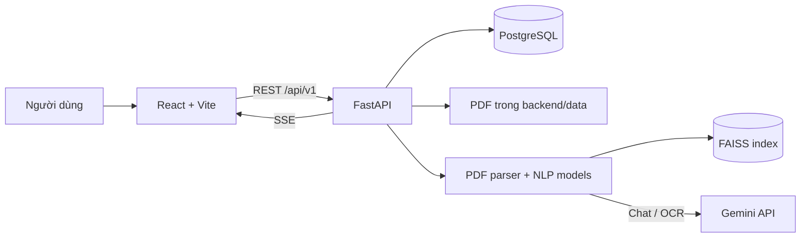

# Kiến trúc và nghiệp vụ hiện tại

**Cập nhật:** 10/11/2026
**Phạm vi:** Mô tả code trong repository hiện tại. Các chức năng chưa có trong code được ghi rõ là chưa triển khai.

## 1. Tổng quan

DAU Second Brain là ứng dụng web gồm frontend React/TypeScript và backend FastAPI. Backend dùng PostgreSQL qua SQLAlchemy, xử lý PDF, lưu embedding và tra cứu vector bằng FAISS. Chatbot sử dụng Gemini; các model tóm tắt/NLI/embedding khác được tải cục bộ từ Hugging Face.

Không có Docker Compose/service-per-module trong repository hiện tại. Backend khởi tạo các bảng bằng `Base.metadata.create_all`; chưa thấy migration framework trong luồng khởi động.

## 2. Thành phần

| Thành phần | Trách nhiệm hiện có |
|---|---|
| `backend/app/main.py` | Tạo FastAPI app, cấu hình CORS, tạo bảng khi startup, lập lịch kiểm tra/crawl văn bản. |
| `backend/app/api/routers/` | Auth, documents, review, search, chat, analytics, audit, reports và system APIs. |
| `backend/app/services/pdf_parser.py` | Trích xuất PDF, có điều kiện OCR ngoài và chia đoạn heuristic. |
| `backend/app/services/nlp_pipeline.py` | Metadata, topic, nghĩa vụ/con số, tóm tắt, NLI, embedding và sinh câu trả lời RAG. |
| `backend/app/services/vector_db.py` | FAISS index và metadata lưu dưới `backend/data/`. |
| `frontend/src/pages/` | Các màn hình tra cứu, phân tích, rà soát, dữ liệu pháp lý và quản trị. |

## 3. Luồng nghiệp vụ thực tế

1. Admin upload PDF hoặc xử lý file đã crawl.
2. PDF được đọc bằng PyMuPDF. Nếu là scan (dưới 20 từ/trang), OCR chỉ chạy khi được phép; upload từ trình duyệt cần xác nhận rõ, file từ crawler công khai được cho phép theo luồng hiện tại.
3. Hệ thống chia đoạn bằng heuristic, bóc metadata và chủ đề bằng regex/keyword scoring, tóm tắt, chọn một đoạn làm ứng viên nghĩa vụ và một đoạn làm ứng viên con số, rồi chạy NLI trên các bản tóm tắt đó.
4. Lưu `Document`, tối đa một bản ghi `Obligation` và một `Threshold` cho luồng extraction hiện tại, các quan hệ trích xuất và vector các đoạn vào FAISS.
5. Obligation/threshold đi vào hàng đợi `pending_review`; admin duyệt, sửa hoặc từ chối từng mục. Sửa tóm tắt sẽ chạy lại NLI server-side; nhãn `contradiction` bị từ chối.
6. Frontend nhận cập nhật tiến trình qua SSE. `GET /legal-data` chỉ trả obligation/threshold đã `published`.
7. Chat truy xuất top-5 FAISS (ngưỡng similarity 0.2), gửi ngữ cảnh cho Gemini và trả citation metadata. Code hiện không lọc vector theo trạng thái `published` và không chạy NLI cho câu trả lời chat.

## 4. Mô hình dữ liệu

Các ORM model trong [`backend/app/db/models.py`](../backend/app/db/models.py):

| Bảng | Dữ liệu chính |
|---|---|
| `users` | Email, password hash, role, active flag. |
| `documents` | Tên file, thư mục nguồn, topic/lĩnh vực, status, metadata, summary, nội dung mục lục JSONB. |
| `obligations`, `thresholds` | Trích xuất, nguồn, status, summary và NLI label. |
| `document_relations` | Source/target, relation type, status, nguyên văn. |
| `document_embeddings` | Content và embedding JSONB; FAISS manager cũng duy trì index trên đĩa. |
| `audit_trails` | Hành động review và nội dung trước/sau sửa. |
| `chat_sessions`, `chat_messages` | Lịch sử chat và citations. |

Code hiện không khai báo các bảng `DocumentChunk`, `ReportTemplate`, `ReviewItem`, `Topic` hay `QueryLog` như một số bản thiết kế trước đây mô tả.

## 5. API và phân quyền

API prefix mặc định là `/api/v1`; Swagger UI được FastAPI cung cấp tại `/docs`.

- Auth: `POST /auth/login`, `GET /auth/me`.
- Documents: upload, PDF, chi tiết, topics, legal data, impact graph, process/reprocess/delete.
- Review: pending, revalidate, publish, reject.
- Search/chat: `GET /search`, `POST /chat`, lịch sử sessions.
- Admin/system: crawl, ping, file chờ xử lý, audit logs, auditing warnings.
- Reports: `GET /reports/template/{document_id}`.

Frontend giới hạn một số route cho role `admin`; backend dùng dependency `get_current_user` hoặc `get_current_admin` tùy endpoint. Không nên coi mọi API đều có cùng chính sách xác thực; xem dependency trong router và OpenAPI trước khi triển khai.

## 6. Crawler và tác vụ nền

Khi app start, APScheduler chạy `check_new_chinhphu` mỗi 30 phút và `crawl_chinhphu(10)` lúc 02:00. Crawler đọc `vanban.chinhphu.vn`, lọc PDF theo năm/lĩnh vực và lưu dưới `backend/data/vanban_caotudong`. Endpoint crawl thủ công giới hạn 5 file/lần. Đây không phải queue worker phân tán; extraction upload chạy bằng FastAPI `BackgroundTasks`.

## 7. Giới hạn và phạm vi chưa triển khai

- Không có luồng tóm tắt từng câu kèm citation mapping hay “zero hallucination gate” cho toàn văn.
- NLI hiện áp dụng lên summary của các mục extraction/review; Publish Gate không tương đương kiểm duyệt từng câu của toàn bộ văn bản.
- RAG chat không đảm bảo chỉ dùng nội dung đã publish.
- Tìm kiếm `/search` là lọc SQL theo tên file, chủ đề, tags; không phải semantic search.
- Cây/đồ thị quan hệ dựa trên rule-based relation records, không có semantic relation.
- Report endpoint sinh DOCX bằng các form cố định theo nhóm tên file; chưa có template library quản trị được.
- Không có kết quả benchmark precision/recall/F1/ROUGE/BERTScore được lưu trong repository.
- OCR gửi ảnh trang ra Gemini bên ngoài; không dùng Tesseract cục bộ. Cần được người vận hành chấp thuận và cấu hình riêng.

Xem hướng dẫn chạy và endpoint mẫu tại [`usage.md`](usage.md), luồng chi tiết tại [`workflow.md`](workflow.md), và kỹ thuật NLP tại [`CÁC THUẬT TOÁN SỬ DỤNG.md`](CÁC%20THUẬT%20TOÁN%20SỬ%20DỤNG.md).
