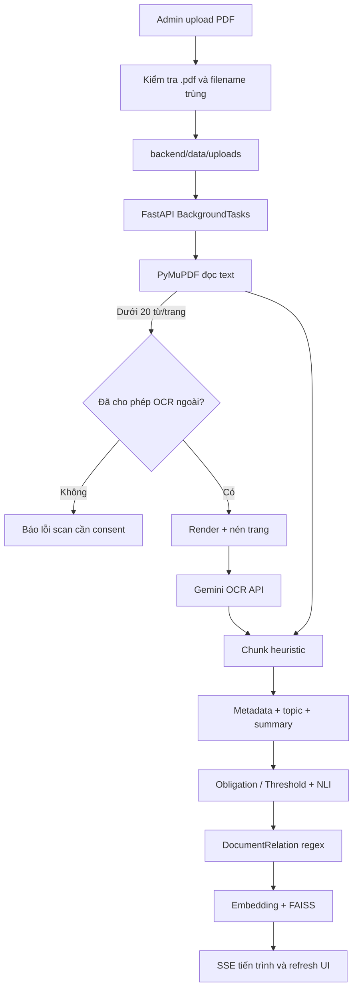

# Luồng xử lý thực tế

**Cập nhật:** 10/11/2026

## 1. Upload PDF

Upload chỉ nhận PDF. Tài liệu scan cần xác nhận trên giao diện vì ảnh trang được gửi ra dịch vụ Gemini OCR; cấu hình kích thước/trang giới hạn được khai báo trong settings.

## 2. Crawl văn bản

`backend/app/main.py` khởi chạy APScheduler:

- `check_new_chinhphu` mỗi 30 phút.
- `crawl_chinhphu(10)` lúc 02:00.

Crawler đọc `vanban.chinhphu.vn`, lọc link PDF theo năm/lĩnh vực, tải tới thư mục `backend/data/vanban_caotudong`. Admin cũng có thể chạy crawl thủ công (tối đa 5 file mỗi request) hoặc đưa file đã crawl vào xử lý. Crawl không phải crawler nhiều nguồn như một số tài liệu cũ mô tả.

## 3. Trích xuất và review

- Parser dùng PyMuPDF; OCR API chỉ là fallback có điều kiện.
- `chunk_document` chọn kiểu phân đoạn theo cấu trúc tìm được; nội dung đoạn được dùng trong tiến trình nhưng không persist như bảng chunk riêng.
- Metadata trích bằng regex; topic chọn theo điểm từ khóa.
- Hệ thống chọn đoạn ứng viên nghĩa vụ và ngưỡng, trích thông tin theo pattern, sinh summary ViT5 và NLI label bằng mDeBERTa.
- Relation được trích bằng regex và lưu `DocumentRelation`.
- Obligation/threshold được tạo ở trạng thái `pending_review`. Review API cho phép sửa/publish hoặc reject; khi sửa, backend chạy lại NLI và từ chối nếu nhãn là `contradiction`.
- Audit trail lưu thao tác review. Tiến trình được đẩy qua SSE.

Đây không phải extraction toàn bộ nghĩa vụ/con số hoặc moderation từng câu của toàn văn. Độ chính xác phụ thuộc định dạng, OCR, pattern và dữ liệu.

## 4. Tìm kiếm và chat

- `GET /search` lọc `filename`, `chu_de`, `tags` trong PostgreSQL và hỗ trợ page/limit; không dùng embedding.
- `/chat` tạo embedding bằng MiniLM, lấy tối đa 5 kết quả từ FAISS với ngưỡng mặc định 0.2, đưa đoạn trích và metadata vào Gemini.
- Tin nhắn và citations được lưu trong `ChatSession`/`ChatMessage`.
- Code chat hiện không giới hạn truy xuất theo trạng thái `published`, không chạy NLI trên câu trả lời và có thể trả về nội dung không đủ căn cứ. Cần người dùng xác minh citation/source.

## 5. Legal data, graph, audit và report

- `GET /legal-data` cung cấp obligation/threshold đã `published`, các hạn chót, sự kiện hiệu lực được suy ra từ records, và một số số liệu phân tích.
- `GET /impact` tổng hợp relation từ database; graph không dùng vector similarity.
- `GET /auditing/warnings` so khớp quan hệ `căn cứ` với relation thay thế/bãi bỏ và document status. Kết quả chỉ tốt bằng dữ liệu đã ingest.
- `GET /reports/template/{document_id}` tạo DOCX và chọn một form cố định dựa trên loại tên file. Chưa có thư viện template do người dùng quản lý.

## 6. Trạng thái lỗi và vận hành

OCR có lỗi cấu hình/xác thực/kết nối/response riêng, retry chỉ với lỗi tạm thời theo cấu hình. Ingestion phát thông báo lỗi tiến trình qua SSE. Scheduler và crawler hiện chạy trong cùng process với API; khi nhiều worker/process được khởi chạy, cần xem xét trùng lịch và trạng thái chia sẻ.

Mã nguồn liên quan: [`backend/app/main.py`](../backend/app/main.py), [`backend/app/api/routers/documents.py`](../backend/app/api/routers/documents.py), [`backend/app/services/pdf_parser.py`](../backend/app/services/pdf_parser.py), [`backend/app/services/nlp_pipeline.py`](../backend/app/services/nlp_pipeline.py).
